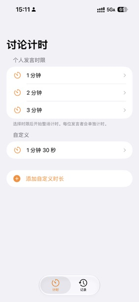
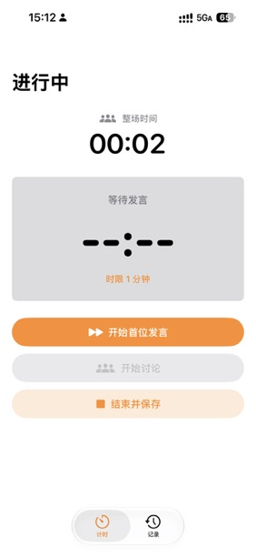
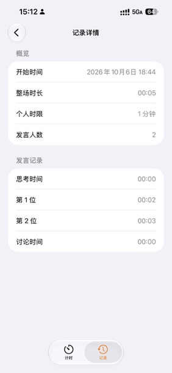
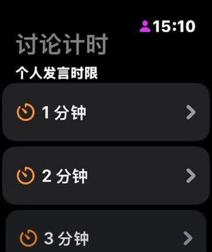
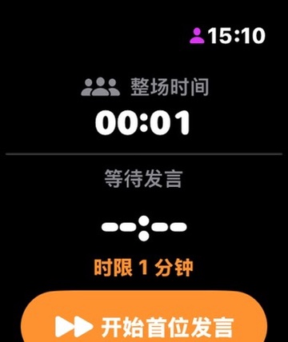
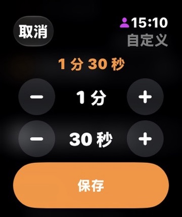

# LGD Timer · 无领导讨论计时工具

用于小组讨论、轮流发言和面试练习的 iPhone / Apple Watch 计时应用，使用 SwiftUI 构建。

选择个人发言时限，依次记录每位发言者的用时，再进入集中讨论；结束后回看整场记录。

## 功能

- **预设与自定义时限**：提供 1、2、3 分钟预设，也可添加自定义时长。
- **分阶段计时**：记录开始发言前的思考时间、每位发言者用时和集中讨论时间。
- **整场计时**：选择时限后开始计算整场用时，点击按钮切换发言者或进入讨论。
- **到时反馈**：当前计时界面在个人发言达到时限时触发触觉反馈。
- **历史记录**：保存、查看和删除讨论记录，回顾总时长、发言人数和各阶段用时。

两端目前独立存储数据，未实现 iPhone 与 Apple Watch 之间的记录同步。当前实现未提供后台通知或后台持续提醒服务。

## 界面预览

### iPhone

<table>
<tr><th>选择时限</th><th>计时界面</th><th>记录详情</th></tr>
<tr>
<td></td>
<td></td>
<td></td>
</tr>
</table>

### Apple Watch

<table>
<tr><th>选择时限</th><th>计时界面</th><th>自定义时限</th></tr>
<tr>
<td></td>
<td></td>
<td></td>
</tr>
</table>

[查看全部 14 张截图](docs/screenshots/README.md)

## 构建与运行

当前工程在 Xcode 27.0 环境下整理；此次文档整理未进行编译验证。

| Target / Scheme | 最低系统版本（工程配置） |
| --- | --- |
| `LGD Timer iPhone` | iOS 17.0 |
| `LGD Timer` | watchOS 10.0 |

1. 克隆或下载仓库，使用 Xcode 打开 `LGD Timer.xcodeproj`。
2. 选择 `LGD Timer iPhone` 或 `LGD Timer` Scheme，并选择对应模拟器。
3. 点击 Run（⌘R）运行。
4. 真机运行时，在对应 Target 的 **Signing & Capabilities** 中选择自己的开发团队，并按需修改 Bundle Identifier。

工程包含作者的开发团队配置，其他开发者需要使用自己的签名配置。两个 Target 的最低版本如上；项目级另有 iOS 27.0 默认值，新增 Target 时需检查继承设置。

## 使用流程

1. 选择预设或自定义的个人发言时限，开始整场计时。
2. 点击「开始首位发言」，开始记录第一位发言者用时。
3. 点击「下一位发言」，记录上一位用时并开始下一位计时。
4. 点击「开始讨论」，进入集中讨论阶段。
5. 点击「结束并保存」，随后在历史记录中查看详情。

## 项目结构

```text
LGD Timer/                  # Apple Watch 应用（SwiftUI / WatchKit）
LGD Timer iPhone/           # iPhone 应用（SwiftUI / SwiftData）
LGD Timer.xcodeproj/        # Xcode 工程与共享 Scheme
docs/screenshots/          # 应用截图及完整图集
```

Apple Watch 使用 AppStorage 保存自定义时限和编码后的历史记录；iPhone 使用 AppStorage 保存自定义时限，使用 SwiftData 保存讨论记录。

## 许可证

目前尚未指定开源许可证。如需复用或分发，请先联系作者确认授权。
