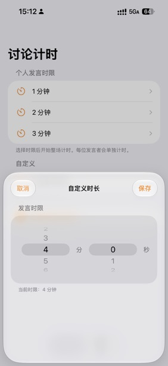
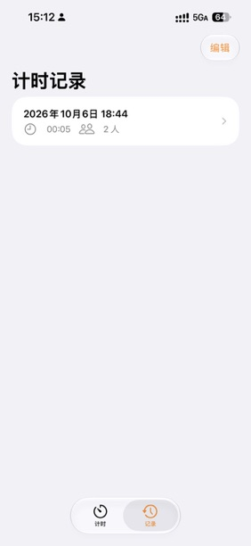
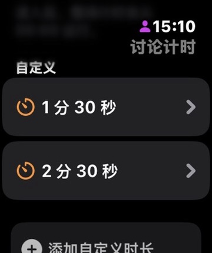
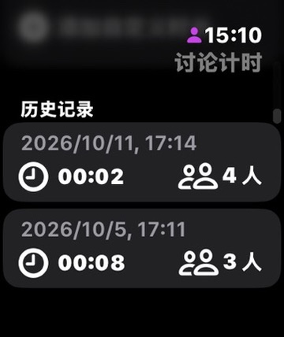
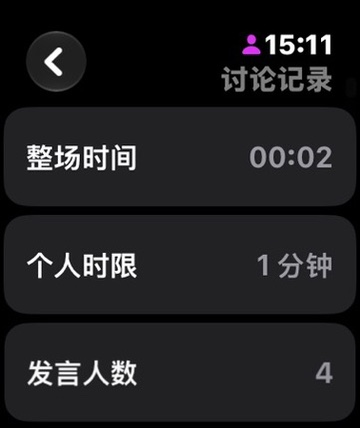
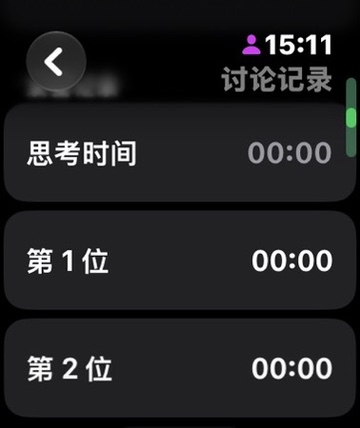
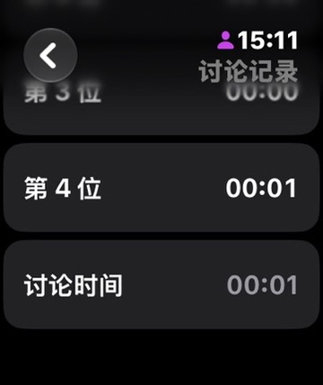

# 应用截图

截图保留原始内容，以下为不同页面及滚动位置。

## iPhone

### iPhone · 选择时限

### iPhone · 计时界面

### iPhone · 自定义时限

### iPhone · 历史记录

### iPhone · 记录详情

## Apple Watch

### Apple Watch · 预设时限

### Apple Watch · 自定义时限列表

### Apple Watch · 历史记录

### Apple Watch · 编辑自定义时限

### Apple Watch · 计时界面

### Apple Watch · 计时操作

### Apple Watch · 记录概览

### Apple Watch · 发言用时

### Apple Watch · 讨论用时

